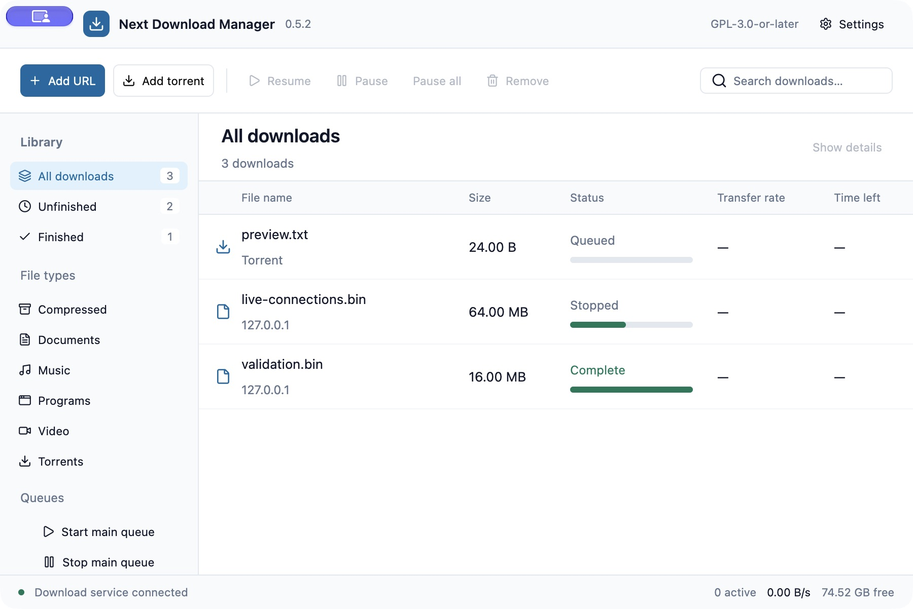

# Next Download Manager（NDM）

<p align="center">
  
</p>

基于 Rust 的原生桌面下载管理器（当前版本 **`v0.0.1`**），界面采用 **GPUI + shadcn/ui 风格**（支持 macOS 原生毛玻璃与系统浅/深色跟随），下载核心与界面解耦设计。当前主要在 **macOS Apple Silicon** 上开发与验证。

> **项目说明**：本仓库是 [Mister Download Manager](https://github.com/anefzaoui/misterdownloadmanager) 的修改分支，由 [zekeeol](https://github.com/zekeeol) 维护修改（最近更新：**2026-11-24**）。项目基于原作者 **Ahmed Nefzaoui** 及上游贡献者的工作进行重构与扩展，保留 **GPL-3.0-or-later** 协议及全部原始署名。

[快速开始](#快速开始macos) · [浏览器扩展](#浏览器扩展) · [架构概览](#架构概览) · [开发与检查](#开发与检查) · [上游说明与许可证](#上游说明与许可证)

## 界面预览



## 当前功能与支持范围

| 模块 | 当前状态 |
| --- | --- |
| HTTP / HTTPS / FTP / FTPS | 支持分段并发、暂停续传、队列并发数控制、全局/单任务限速、流式速率平滑与完成平均速度/耗时统计 |
| Torrent / 磁力链接 | 支持元数据预览、文件多选、Tracker / DHT / Peer 进度、多源 Extra Tracker 订阅同步、做种时间/分享率限制，并修复磁力元数据阶段 `left=0` 上报问题 |
| GPUI 原生桌面 | macOS 原生毛玻璃窗体（`WindowBackgroundAppearance::Blurred`）、`System` / `Light` / `Dark` 三态实时主题、列表筛选搜索、连接详情与键盘导航 |
| 浏览器扩展（`v0.0.1`） | 支持下载接管、磁力链接、`.torrent` 预览、站点排除与打开应用 / 设置 |
| 数据与持久化 | 独立 `core.json` 原子写入与备份恢复（默认数据目录可用 `NDM_DATA_DIR` 覆盖） |
| 尚未迁入 / 平台说明 | 视频提取、图库、debrid 与完整调度界面暂未迁入 GPUI；Windows / Linux 尚未完成原生版验收 |

详细变更记录见 [CHANGELOG.md](CHANGELOG.md)。

## 快速开始（macOS）

前置依赖：Rust stable（>= 1.98）、Xcode Command Line Tools、Python 3.11+。

```sh
# 开发构建（含应用图标、配套扩展与本地签名）
bash tools/installer/build-local-macos.sh

# 启动应用
open "target/dist/Next Download Manager.app"

# Release 优化构建（搭配 strip 约 28 MB）
bash tools/installer/build-local-macos.sh release
```

本地打包使用 ad hoc 签名（Bundle ID：`com.nextdownloadmanager.app`），配套浏览器扩展会同步输出至 `target/extension/`。

## 浏览器扩展

扩展与主程序版本统一为 **`v0.0.1`**，使用独立 Chromium ID（`mnnniimekbcglecjidnckfjigmmkmgmc`）及原生消息主机名 `com.nextdownloadmanager.host`。**请加载本仓库构建的扩展，不要混用上游浏览器商店版本。**

1. 启动打包后的应用，在 **Settings → General → Register host** 注册原生主机。
2. Chromium 系列浏览器在扩展管理页开启开发者模式，加载已解压的 `target/extension/chromium`。
3. Firefox 在 `about:debugging` 临时加载 `target/extension/firefox/manifest.json`。

完整安装、打包与 Safari 说明见 [原生版浏览器扩展指南](docs/native-browser-extension.md)。

## 架构概览

```text
ndm-app（crates/desktop：GPUI 界面）
    │ 本机认证 IPC（127.0.0.1 + token）
ndm-backend（crates/service：后台服务与进程管理）
    │
ndm-core（crates/core：任务、队列、设置与持久化）
    ├── ndm-engine：直链分段下载、续传与校验
    └── ndm-torrent：元数据、文件选择与传输

ndm-ipc / ndm-nmhost / ndm-cli / ndm-mcp：协议与独立适配器
```

`ndm-core` 与 `ndm-backend` 完全独立于 GUI 框架；原 `egui`（`ndm-legacy`）界面已移除，全桌面端统一使用 GPUI。详见 [原生架构与兼容边界](docs/native-architecture.md)。

## 开发与检查

```sh
# 构建并运行原生桌面与配套组件
cargo build -p ndm-app -p ndm-backend -p ndm-cli -p ndm-nmhost -p ndm-mcp
cargo run -p ndm-app

# 使用隔离数据目录运行
NDM_DATA_DIR=/absolute/path/to/qa-data cargo run -p ndm-app
```

常用验证命令：

```sh
cargo fmt --all -- --check
cargo check --workspace --all-targets
cargo clippy --workspace --all-targets -- -D warnings
cargo test -p ndm-app
cargo test -p ndm-core
cargo test -p ndm-ipc
cargo test -p ndm-crash --test in_frame
python3 tools/dev/check-layering.py
python3 tools/extension/pack.py && node tools/extension/check-pack.mjs && node tools/extension/test.mjs
```

## 相关文档

- [原生架构与兼容边界](docs/native-architecture.md)
- [原生版浏览器扩展指南](docs/native-browser-extension.md)
- [原生设计规范](crates/desktop/DESIGN.md)
- [安全审查报告](docs/security-review.md)
- [第三方组件与素材署名](ATTRIBUTION.md)

## 上游说明与许可证

- 本项目派生自 [Mister Download Manager](https://github.com/anefzaoui/misterdownloadmanager)（原作者：**Ahmed Nefzaoui** 及上游贡献者）。
- 本分支将 Rust 包名前缀由 `mdm-*` 迁移为 `ndm-*`，重构了核心服务与 GPUI 原生界面，并已移除旧版 `egui` 前端。
- 上游项目的官方发行包、网站、历史文档与浏览器商店扩展均属于原项目，与本分支的本地构建独立；上游介绍与贡献者列表请参阅[原项目仓库](https://github.com/anefzaoui/misterdownloadmanager)。
- 本项目继续采用 [GPL-3.0-or-later](LICENSE) 许可证，保留所有原始版权声明与第三方素材署名（详见 [ATTRIBUTION.md](ATTRIBUTION.md)）。本分支新增组件包括 GPUI Kit（Apache-2.0）、Lucide 图标（ISC）及原生应用图标。
