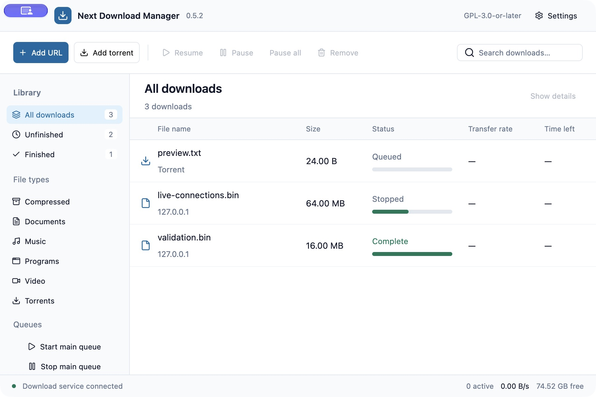

# Next Download Manager — documentation (`v0.0.1`)

Next Download Manager (**NDM**) is a free, open-source (**GPL-3.0-or-later**) desktop download manager built in Rust with a native **GPUI (`gpui-kit`)** interface and a decoupled download core (`ndm-core`, `ndm-engine`, `ndm-torrent`).

> **Current focus (`v0.0.1`):** Primary verified environment is **macOS Apple Silicon** with native GPUI frosted-glass UI, `System / Light / Dark` themes, multi-connection HTTP/FTP transfers, BitTorrent/magnet downloads, and companion Chromium/Firefox browser integration. Legacy `egui` (`crates/app`) has been removed.

## Native GPUI Desktop (`v0.0.1`)

- **[Getting started](getting-started.md)** — install or build NDM `v0.0.1` on macOS (`target/dist/Next Download Manager.app`), configure themes, and start downloading.
- **[Native architecture](native-architecture.md)** — decoupled `ndm-app` / `ndm-backend` / `ndm-core` design, atomic `core.json` persistence, torrent authorization, and macOS packaging.
- **[Workspace architecture](ARCHITECTURE.md)** — full crate map, segmented download engine, GPUI shell/vibrancy/theme system, and browser messaging flow.
- **[Native design spec](../crates/desktop/DESIGN.md)** — GPUI frosted-glass layers, System/Light/Dark semantic palettes, and component tokens.
- **[Native browser extension](native-browser-extension.md)** — Chromium (`mnnniimekbcglecjidnckfjigmmkmgmc`) and Firefox setup, native messaging host registration (**Settings → General → Register host**), and boundaries.
- **[Themes](themes.md)** — macOS frosted glass (`WindowBackgroundAppearance::Blurred`) and `System / Light / Dark` theme switching.
- **[Keyboard shortcuts](keyboard-shortcuts.md)** — shortcuts, focus navigation, and accessibility support in the GPUI window.
- **[Security review](security-review.md)** — local source audit, IPC/path/torrent protections, and verified scope.

## Engine, CLI & Protocol Reference

- **[Connections and speed](connections-and-speed.md)** — segmented downloads, pause/resume, EWMA speed smoothing, speed limiters, and completion metrics.
- **[Torrents](torrents.md)** — magnet links, `.torrent` file selection, extra tracker subscriptions, seeding time/ratio limits, and DHT/uTP controls.
- **[Torrents and your security](torrent-security.md)** — peer visibility, network switches, and path/symlink protections.
- **[Command line and automation](command-line.md)** — `nextdownloadmanager-cli` and the local loopback automation API ([JSON Schema](automation-api.schema.json)).
- **[AI assistants (MCP)](ai-assistants.md)** — connect Claude, Cursor, VS Code, or other MCP clients via `nextdownloadmanager-mcp`.
- **[Run headless / Docker server](server.md)** — run `nextdownloadmanager-backend --headless` on a server or NAS.

## Upstream Reference Guides (Features Pending GPUI Migration)

These guides document engine modules and upstream Mister Download Manager features that are not yet exposed in the `v0.0.1` GPUI UI:

- **[Adding downloads](adding-downloads.md)** · **[The download list](download-list.md)** · **[Browser integration](browser-integration.md)** · **[Browser troubleshooting](browser-help.md)**
- **[Video downloads](video.md)** · **[Image galleries](galleries.md)** · **[Link grabber & archives](link-grabber.md)** · **[Debrid accounts](debrid.md)**
- **[Queues and the Scheduler](queues-and-scheduler.md)** · **[Remote control](remote-control.md)** · **[Options](options.md)** · **[Portable mode](portable.md)** · **[Languages](languages.md)**
- **[Crash reports](crash-reports.md)** · **[Troubleshooting](troubleshooting.md)** · **[Your first download](guide-first-download.md)** · **[Catch browser downloads](guide-catch-browser-downloads.md)** · **[Download overnight](guide-download-overnight.md)** · **[Resume a broken download](guide-resume-broken-download.md)** · **[Keep speed for everything else](guide-keep-speed-for-everything-else.md)** · **[Download a video from a page](guide-video-from-page.md)** · **[Carry NDM on a USB stick](guide-usb-stick.md)** · **[Find a download in a long list](guide-find-in-long-list.md)**

## Project & Support

- **[Releases](https://github.com/zekeeol/NextDownloadManager/releases)** — releases and build artifacts.
- **[Report a problem](https://github.com/zekeeol/NextDownloadManager/issues/new/choose)** — open an issue with your version (`v0.0.1`) and OS details.
